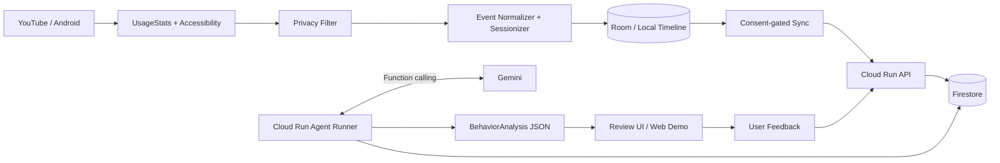
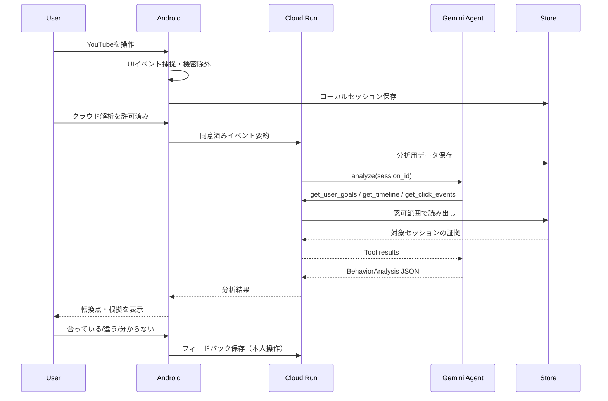

# MVPアーキテクチャ

## ランタイム境界

- **端末側**：セッション開始/終了・イベント捕捉・文言取得可否・機密除外・タイムライン作成。Accessibility callbackは軽く保ち、非同期で保存する。
- **クラウド側**：同意済みイベントに限って受信/保管。GeminiがToolで証拠を取得し、根拠付き仮説を出す。
- **Agent Runner**：Geminiのfunction callsをループ処理。ツールはサーバー側にあり、セッションIDと認可ユーザーでスコープ制限する。
- **UI**：初回Goal/YouTube選択、イベントタイムライン、セグメント説明、根拠、確認/訂正。Webデモのsample/real表示は必須。

## 典型的な分析シーケンス

## 決定事項

- Geminiはタップ検出器ではない。Androidが観測したイベントを**時系列の証拠**として扱う。
- ゴールは本人が確認した内容を正とし、AIの観測仮説で勝手に書き換えない。
- 介入エンジンはP1。今回のMVPの完成条件に含めない。
- 仕様上の未決事項は `process/RISKS_AND_DECISIONS.md` に記録する。
