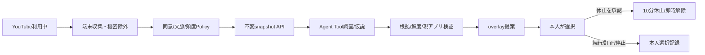
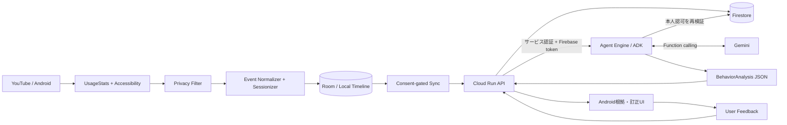
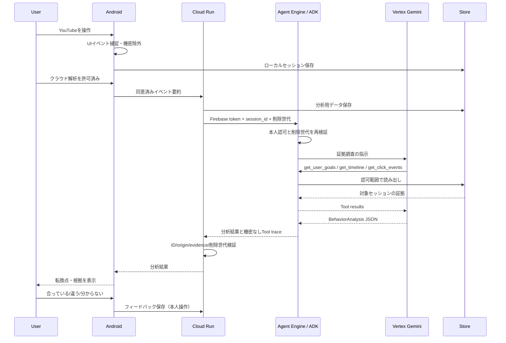

# MVPアーキテクチャ

## v0.3目標構成（開発中）

現行要件: requirements/REQUIREMENTS_v0.3.md。旧手動導線は下記に保持する。自動ルートは未接続。

端末は観測の変化で有界Agentを起動する。モデルは継続監視や制限実行を直接行わない。旧セッション凍結同期を変更せず、現在の観測は別snapshot契約で送信する。本人確認済みゴール/owner/同意revision/削除世代/文脈sequenceを結果と照合する。詳細と実装依存はDG-301〜308を参照。

## v0.2から継承する既存構成

## ランタイム境界

- **端末側**：セッション開始/終了・イベント捕捉・文言取得可否・機密除外・タイムライン作成。Accessibility callbackは軽く保ち、非同期で保存する。
- **クラウド側**：同意済みイベントに限って受信/保管。GeminiがToolで証拠を取得し、根拠付き仮説を出す。
- **Agent Runner**：現在はAgent Engine上のADK。Geminiのfunction callsを処理し、ToolはセッションIDと認可ユーザーでスコープ制限する。Cloud Run側でも結果のID/origin/evidence/削除世代を再検証する。
- **UI**：Androidの初回Goal/YouTube選択、イベントタイムライン、セグメント説明、根拠、確認/訂正。sample/realを区別する。WebデモはMVP対象外。

## 典型的な分析シーケンス

## 決定事項

- Geminiはタップ検出器ではない。Androidが観測したイベントを**時系列の証拠**として扱う。
- ゴールは本人が確認した内容を正とし、AIの観測仮説で勝手に書き換えない。
- v0.3では自動提案と本人承認による休止をP0へ変更。未承認の制限は行わない。
- 仕様上の未決事項は `process/RISKS_AND_DECISIONS.md` に記録する。
